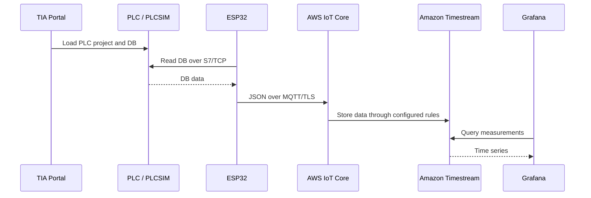

# Architecture and data flow

The gateway reads process measurements from a Siemens S7-1500 PLC and sends them to AWS for monitoring in Grafana. The main firmware uses a DB of at least 312 bytes, containing five measurements, PLC date text and counters. See [firmware data layout](firmware.md#data-layout-and-payload).

TIA Portal manages the PLC project; PLCSIM supports the simulated bench. The ESP32 reads the DB through Settimino and publishes JSON to AWS IoT Core over MQTT with TLS.



The repository contains the ESP32 firmware and its software checks. IoT rules, Timestream tables, IAM permissions and Grafana dashboards require separate configuration and are not included. Cloud persistence depends on the configured rules and permissions.

## Historical 26-byte profile

`archive/sketches/PLC_AWS_testing` uses **DB2**, reading **26 bytes** from offset 0 with rack **0**, slot **1**. This profile differs from the main firmware.

| Field | DB position | Settimino read | JSON field |
|---|---|---|---|
| Machine state | Byte 0, bit 0 | `S7.BitAt(0, 0)` | `Machine State`: `ON` / `OFF` |
| Pressure | Bytes 2–5 | `S7.FloatAt(2)` | `Pressure` |
| 10 components | Bytes 6–25, step 2 | `S7.IntegerAt(6 + i * 2)` | `Components`: 10-value array |

Pressure units and the meaning of component values must be defined in the PLC project. Example with **dummy values**:

```json
{
  "Machine State": "ON",
  "Pressure": 1.25,
  "Components": [1, 2, 3, 4, 5, 6, 7, 8, 9, 10],
  "TimeStamp": "2024-04-01 12:00:00",
  "Counter": 0
}
```

The historical topic is `esp32/counter`. The loop adds a five-second pause to read and network delays, so it does not provide deterministic five-second sampling. Publishing depends on `DataChanged`; see [historical limitations](historical-versions.md#known-issues).

## Historical relay commands

Four topics, `esp32/relay1`–`esp32/relay4`, map to GPIO 15, 2, 4 and 22. The historical callback converts `status` to an integer and applies `digitalWrite(pin, !r)`. These commands affect ESP32 outputs, not the PLC DB. The main firmware uses the stricter validation described in [optional relays](firmware.md#optional-relays).

## Monitoring

Timestream and Grafana support inspection of measurements over time. The firmware handles acquisition and transport; it does not implement a dedicated anomaly-detection model. Performance assessment and cloud commissioning require bench testing.
